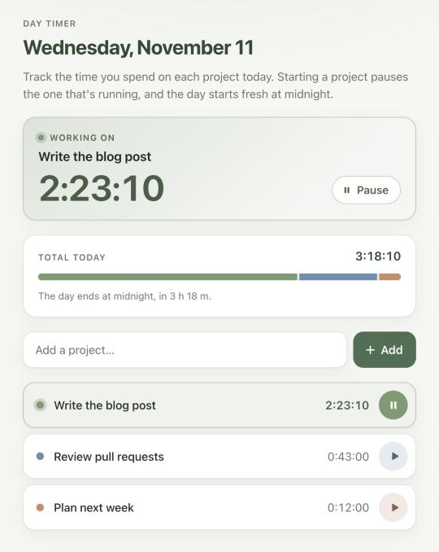

# Temporal Day Timer

[](https://github.com/swetapatel2121/temporal-day-timer/actions/workflows/test.yml)

A small web app for tracking the time you spend on each project during a day, built using [Temporal](https://temporal.io). Each project's timer is a Temporal workflow that lives until midnight.



## What it does

- Add the projects you're working on today, then start, pause and resume each one.
- Only one project runs at a time. Starting one pauses the one that's running.
- After a project has been running for 2 hours, you get a "Still running?" Mac notification.
- At midnight every timer ends, and the next day starts empty.

## How it uses Temporal

- **One workflow per project per day**, with the ID `project-<name>-<date>`. It sleeps until midnight on a durable timer, so a project's time survives restarting the worker, the server or the whole Mac.
- **Updates** (`start`, `pause`) change the project and return it. A **signal** (`otherProjectStarted`) pauses the project that was running. A **query** (`getProject`) reads it.
- **The nudge** is a second timer, on its own workflow thread (`Async.procedure` inside a `CancellationScope`), and pausing cancels it.
- **An activity** (`notifyUser`) shows the notification, since workflow code can't do I/O. Temporal tries it up to 3 times.
- **The tests** run a whole day in milliseconds with Temporal's time-skipping test environment, with the activity mocked.

[ROADMAP.md](ROADMAP.md) has the design, the API, and the steps it was built in.

## Prerequisites

Built and tested on macOS. The notification and `make start-project-timer-workflow` are Mac-only; the rest works anywhere the Temporal CLI does.

- JDK 25 or later, for example `brew install --cask temurin` (check with `java -version`)
- Maven: `brew install maven`
- [Temporal CLI](https://docs.temporal.io/cli): `brew install temporal`
- Optional: [terminal-notifier](https://github.com/julienXX/terminal-notifier), so clicking a nudge opens the page: `brew install terminal-notifier`

## Run it

```bash
git clone https://github.com/swetapatel2121/temporal-day-timer.git
cd temporal-day-timer
```

Then run these three, each in its own terminal in the project folder. The first one that builds the code downloads the Java dependencies, so it takes a minute.

1. Start the Temporal dev server. It saves workflows to `temporal.db`, and its Web UI is at http://localhost:8233.

   ```bash
   make temporal
   ```

2. Start the worker, which runs the workflows and the notification activity:

   ```bash
   make project-timer-worker
   ```

3. Start the HTTP server, which also serves the page:

   ```bash
   make server
   ```

Then open http://localhost:7070. Run `make` to list all the commands.

## Using it

- Type a project name and press **Add**. Press ▶ to start its timer and ❚❚ to pause it.
- Starting another project pauses the one that's running.
- The page ticks the time itself, and fetches the list every 30 seconds, so a nudge or a change made with `curl` shows up.
- At midnight the page moves to the new day by itself.

## The "Still running?" nudge

After a project has been running for 2 hours, the worker shows a Mac notification and the page asks "Still working on this?". To try it without waiting, start the server with a shorter nudge, in milliseconds. It applies to projects added after the server starts:

```bash
NUDGE_AFTER_MS=60000 make server
```

With terminal-notifier installed, clicking the notification opens the page. Allow it to send notifications first, in System Settings → Notifications → terminal-notifier. Without it, or until it's allowed, the nudge is shown with `osascript`, and clicking it opens whatever macOS picks. If no notification appears at all, check that Script Editor is allowed to send notifications.

## Look inside with Temporal

- Open the Web UI at http://localhost:8233 to see each project's workflow and its history: the `start` and `pause` updates, the signal when another project starts, and the timers.
- Start a project's workflow from the command line, the same way **Add** does:

  ```bash
  make start-project-timer-workflow NAME=myproject
  ```

- Check that the worker is polling its task queue:

  ```bash
  make describe
  ```

- Try the experiments in [Things to try](ROADMAP.md#things-to-try), like stopping the worker while a project runs.

## The API

The page uses a small JSON API, which you can also call yourself:

```bash
curl -X POST localhost:7070/api/projects -H 'Content-Type: application/json' -d '{"name":"edit readme"}'
curl -X POST localhost:7070/api/projects/edit%20readme/start
curl -X POST localhost:7070/api/projects/edit%20readme/pause
curl localhost:7070/api/projects
```

The [API section of the ROADMAP](ROADMAP.md#api) describes each route, the project's fields and the errors.

## Tests

```bash
make test
```

- **Workflow tests** use Temporal's time-skipping test environment, with the notification activity mocked.
- **Activity tests** are plain unit tests with a fake command runner, so no notification pops up.
- **HTTP server tests** start their own throwaway Temporal dev server with the Temporal CLI, on free ports, so they don't need or touch the one from `make temporal`.

GitHub Actions runs the same tests on every pull request.

## Project layout

```
src/main/java/daytimer/            the worker
src/main/java/daytimer/model/      the Project record that the API returns
src/main/java/daytimer/workflow/   the workflow and the notification activity
src/main/java/httpserver/          the HTTP API (Javalin), which also serves web/
web/                               the page: plain HTML, CSS and JavaScript, with no build step
src/test/java/                     the tests
```

## Troubleshooting

- **Adding a project fails with "the server answered 500".** The worker is probably running older code. Stop `make project-timer-worker` with Ctrl+C and start it again. Restart it whenever the workflow or activity code changes.
- **A workflow ended hours after midnight.** The Mac was asleep at midnight, so the dev server's timer fired when it woke up. The times still only count up to midnight, and the page only shows today's projects.
- **No notification.** See [the nudge](#the-still-running-nudge) above for the System Settings to check.
